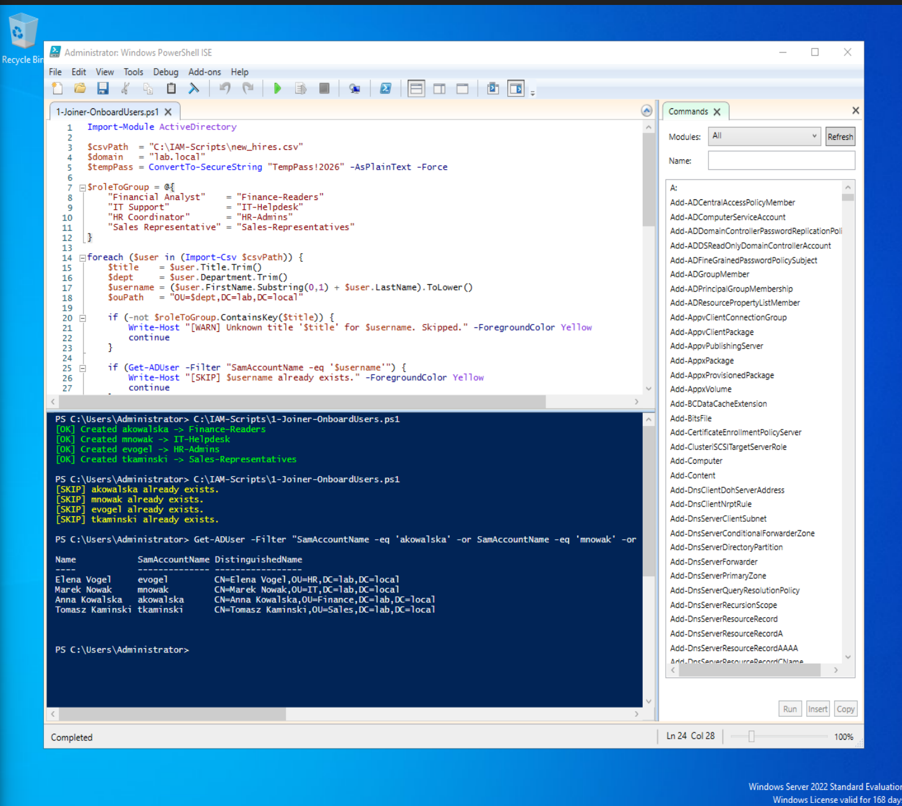
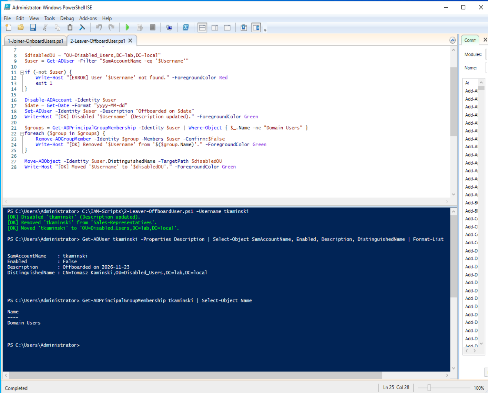
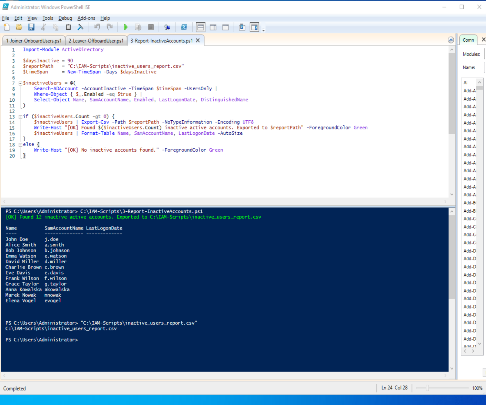
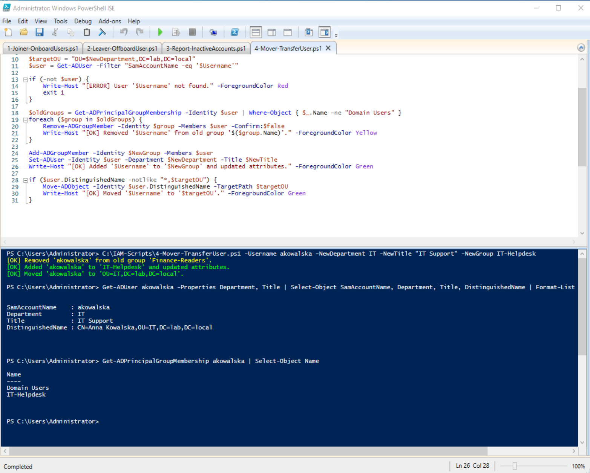

# PowerShell Joiner-Mover-Leaver Automation ⚙️🔐

## 1. Scenario
- **Lab Environment:** Windows Server 2022 Domain Controller (`lab.local`), built in [Week 3](https://github.com/vladyslavsirenko/IAM-Security-Lab/tree/main/windows-server-ad-lab).

> After creating users and security groups by hand in the AD GUI last week, **I automated the Joiner, Mover, and Leaver (JML) lifecycle** and inactive account reporting with **PowerShell.**

**Goal for this lab:**
- Onboard new hires from an HR CSV file into the right OUs and security groups.
- Offboard leavers without deleting the account or losing audit history.
- Report enabled accounts that have been inactive for 90+ days.
- Handle department transfers without leaving old permissions behind.

*Date of Lab: 23 November 2026*

---

### 📂 Lab Setup & Input Data

**Active Directory Structure (`lab.local`):**
- **OUs:** `Finance`, `HR`, `IT`, `Sales`, `Disabled_Users`
- **Security Groups:** `Finance-Readers`, `HR-Admins`, `IT-Admins`, `IT-Helpdesk`, `Sales-Managers`, `Sales-Representatives`
- **Scripts Folder:** `C:\IAM-Scripts` (Execution Policy: `RemoteSigned`)

**Sample HR Export (`new_hires.csv`):**
| FirstName | LastName | Department | Title |
|---|---|---|---|
| Anna | Kowalska | Finance | **Financial Analyst** |
| Marek | Nowak | IT | **IT Support** |
| Elena | Vogel | HR | **HR Coordinator** |
| Tomasz | Kaminski | Sales | **Sales Representative** |

*HR only provides business fields. The script maps each job title to the right AD security group internally.*

---

### 🎯 Scripts & Test Results

| Script | Lifecycle Stage | Input | What it does |
| :--- | :--- | :--- | :--- |
| `1-Joiner-OnboardUsers.ps1` | **Joiner** | `new_hires.csv` | Creates accounts, sets `ChangePasswordAtLogon`, places users in department OUs, adds role groups |
| `2-Leaver-OffboardUser.ps1` | **Leaver** | `-Username` | Disables account, logs offboarding date in `Description`, strips groups, moves to `Disabled_Users` |
| `3-Report-InactiveAccounts.ps1` | **Audit / Report** | 90-day threshold | Finds enabled accounts inactive for 90+ days and exports `inactive_users_report.csv` |
| `4-Mover-TransferUser.ps1` | **Mover (Bonus) 🏆** | `-Username`, `-NewDepartment`, `-NewTitle`, `-NewGroup` | Removes old groups, adds new group, updates attributes, moves user to new OU |

---

**1. Joiner (`1-Joiner-OnboardUsers.ps1`)**



Reads `new_hires.csv`, builds each login (`SamAccountName`) from the first initial and last name, and runs two checks before creating an account: whether the job title exists in the `$roleToGroup` hash table and whether that login is already taken in AD. 

! Each new account gets a temporary password with `ChangePasswordAtLogon` set to `$true`.

```powershell command
C:\IAM-Scripts\1-Joiner-OnboardUsers.ps1
```

**First run created all 4 users (`[OK]`) in their department OUs.**

**Running the script a second time skipped all 4 existing accounts (`[SKIP]`) and left their groups untouched:**

```text
[OK] Created akowalska -> Finance-Readers
[OK] Created mnowak -> IT-Helpdesk
[OK] Created evogel -> HR-Admins
[OK] Created tkaminski -> Sales-Representatives

[SKIP] akowalska already exists.
[SKIP] mnowak already exists.
[SKIP] evogel already exists.
[SKIP] tkaminski already exists.
```

---

**2. Leaver (`2-Leaver-OffboardUser.ps1`)**



Tested on `tkaminski`. The script disables the account, writes `Offboarded on 2026-11-23` into `Description`, removes every security group except `Domain Users`, and moves the account to `OU=Disabled_Users,DC=lab,DC=local`.

```powershell command
C:\IAM-Scripts\2-Leaver-OffboardUser.ps1 -Username tkaminski
```

**Console output and verification check:**

```text
[OK] Disabled 'tkaminski' (Description updated).
[OK] Removed 'tkaminski' from 'Sales-Representatives'.
[OK] Moved 'tkaminski' to 'OU=Disabled_Users,DC=lab,DC=local'.

SamAccountName    : tkaminski
Enabled           : False
Description       : Offboarded on 2026-11-23
DistinguishedName : CN=Tomasz Kaminski,OU=Disabled_Users,DC=lab,DC=local
```

Group membership check returned only `Domain Users`.

---

**3. Inactive Accounts Report (`3-Report-InactiveAccounts.ps1`)**



Searches for accounts with 90+ days of inactivity using `Search-ADAccount -AccountInactive -UsersOnly`, filters out already disabled accounts, and exports the list to `C:\IAM-Scripts\inactive_users_report.csv`.

```powershell command
C:\IAM-Scripts\3-Report-InactiveAccounts.ps1
```

**Console output:**

```text
[OK] Found 12 inactive active accounts. Exported to C:\IAM-Scripts\inactive_users_report.csv
```

All 12 enabled lab accounts showed up in the report because none of them had signed in yet. 

! The offboarded `tkaminski` account was excluded automatically because `Enabled` is `False`.

---

**4. Mover (`4-Mover-TransferUser.ps1`)**



Tested by transferring `akowalska` from `Finance` (`Finance-Readers`) to `IT` (`IT-Helpdesk`). 

The script strips old security groups first, adds the new group, updates `Department` and `Title`, and moves the account into `OU=IT,DC=lab,DC=local`.

```powershell command
C:\IAM-Scripts\4-Mover-TransferUser.ps1 -Username akowalska -NewDepartment IT -NewTitle "IT Support" -NewGroup IT-Helpdesk
```

**Console output and verification check:**

```text
[OK] Removed 'akowalska' from old group 'Finance-Readers'.
[OK] Added 'akowalska' to 'IT-Helpdesk' and updated attributes.
[OK] Moved 'akowalska' to 'OU=IT,DC=lab,DC=local'.

SamAccountName    : akowalska
Department        : IT
Title             : IT Support
DistinguishedName : CN=Anna Kowalska,OU=IT,DC=lab,DC=local
```

Group membership check returned `Domain Users` and `IT-Helpdesk` (`Finance-Readers` is gone).

---

### ⚠️ What Could Go Wrong

- **Dirty CSV data from HR:**

> During setup I hit two real typos in `new_hires.csv`: a misspelled column header (`Tittle` instead of `Title`) and an extra space before `Financial Analyst`.

Calling `.Trim()` handles stray spaces and the hash table skips unknown titles, though a wrong column header still breaks the lookup until someone fixes the file.

- **Username collisions:**

> Building logins as first initial + last name breaks when two hires collide (for example, `Anna Kowalska` and `Agnieszka Kowalska` both become `akowalska`).

Right now the script skips duplicates so it never gives a new hire's groups to an existing user, though a real setup needs a fallback rule like adding a number.

- **Hardcoded temporary password:**

> For this lab, the Joiner script uses one temporary password (`TempPass!2026`) with `ChangePasswordAtLogon = $true`.

> In production, passwords cannot sit in plaintext inside a script and should be generated per user or pulled from a vault.

- **New hires flagged as inactive:**

> `Search-ADAccount -AccountInactive` also returns accounts where `LastLogonDate` is empty. Connecting this report to an auto-disable job without checking `WhenCreated` would lock out new hires before their first day.

- **Partial failure in Mover:**

> Passing a misspelled `-NewDepartment` or `-NewGroup` strips the user's old groups before `Add-ADGroupMember` or `Move-ADObject` fails.

**Validating the target OU and group at the start of the script would prevent leaving someone with zero access.** 


---

## 💡 What I learned:  

In [Week 3](https://github.com/vladyslavsirenko/IAM-Security-Lab/tree/main/windows-server-ad-lab), creating 10 users through the AD GUI already felt slow. Writing these four scripts showed me how small details in PowerShell and Active Directory turn into security bugs if you skip checks.  

### Keep group mapping out of HR's CSV.

HR does not type AD group names into `new_hires.csv`. 

The script keeps the job-title-to-group rules inside a PowerShell [hash table](https://learn.microsoft.com/en-us/powershell/module/microsoft.powershell.core/about/about_hash_tables), so HR maintains business data and IT controls access rules. 

❗ **One typo in an HR spreadsheet shouldn't accidentally put a new hire into `IT-Admins`.**  

### Check AD before writing to AD.

If `New-ADUser` fails on a duplicate `SamAccountName` and the script keeps going, `Add-ADGroupMember` can add the new hire's groups to the wrong person's account. 

Adding a `Get-ADUser` check before [New-ADUser](https://learn.microsoft.com/en-us/powershell/module/activedirectory/new-aduser) makes the Joiner script safe to run again when HR adds new rows to the same CSV. 

### Why `CN`, `OU`, and `DC` matter in scripts. 

Before writing the scripts I had to sort out what `CN=Finance-Readers,OU=Finance,DC=lab,DC=local` actually means ([Microsoft's AD object naming docs](https://learn.microsoft.com/en-us/windows/win32/ad/object-names-and-identities) helped here). You read a Distinguished Name from right to left like a folder path. 

- The big difference is that you can link Group Policies (GPOs) to an `OU` like `OU=Disabled_Users`, while you cannot link them to the default `CN=Users` container. 

**That is why [Move-ADObject](https://learn.microsoft.com/en-us/powershell/module/activedirectory/move-adobject) needs the exact target OU path.** 

### Disable and quarantine, don't delete. 

This connects directly to the failed offboarding audit from [Week 1](https://github.com/vladyslavsirenko/IAM-Security-Lab/tree/main/access-review). 

Using [Disable-ADAccount](https://learn.microsoft.com/en-us/powershell/module/activedirectory/disable-adaccount), logging the date in `Description`, stripping groups, and moving the user to `Disabled_Users` blocks login right away while keeping the audit trail intact if anything needs to be checked later.  

### Mover scripts stop privilege creep. 

In [Week 2](https://github.com/vladyslavsirenko/IAM-Security-Lab/tree/main/rbac), 5 out of 6 employees had leftover permissions they didn't need. 

Writing the Mover script to strip old security groups before adding the new one turns that lesson into code. 

- When `akowalska` moved from Finance to IT, `Finance-Readers` was removed automatically.  

### Pipelines, `$_`, and default AD properties.

I struggled at first with how the PowerShell [pipeline](https://learn.microsoft.com/en-us/powershell/module/microsoft.powershell.core/about/about_pipelines) (`|`) passes objects between cmdlets. 

Thinking of it as a conveyor belt made it click: `Search-ADAccount` puts accounts on the belt, `Where-Object` checks each current item (`$_`) to keep only `Enabled -eq $true`, and `Export-Csv` writes the file. 

I also learned that [Get-ADUser](https://learn.microsoft.com/en-us/powershell/module/activedirectory/get-aduser) only returns a short default set of attributes unless you ask for extra fields with `-Properties` (like `Department`, `Title`, or `Description`), and [splatting](https://learn.microsoft.com/en-us/powershell/module/microsoft.powershell.core/about/about_splatting) (`@params`) keeps long commands readable. Testing [Search-ADAccount](https://learn.microsoft.com/en-us/powershell/module/activedirectory/search-adaccount) also showed me why empty `LastLogonDate` values create false positives for brand-new accounts.

### Main takeaway.
Automation makes JML fast and repeatable, **but a script with no validation just scales mistakes faster.** 
**Checking inputs, verifying existing accounts, stripping old groups on transfer, and testing edge cases in a lab first matters just as much as the commands themselves.** ❗
