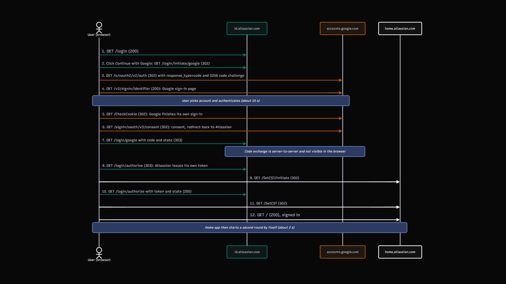
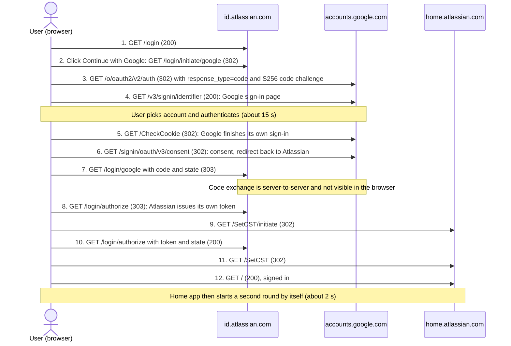

# SSO Sign-in Flow: Google → Atlassian 🔑

## 1. Scenario
My own sign-in to `id.atlassian.com` with the "**Continue with Google**" button, recorded in a private browser window with DevTools (Network tab, Preserve log on) and then sanitized. 

**The goal:** see with real requests how signing in with Google works (OAuth 2.0 and OpenID Connect, the same building blocks as enterprise SSO), who talks to whom, and what travels in the URLs.

> This is a personal lab. All tokens, codes, identifiers and cookies are removed before publishing. The raw export is never committed.

---

## 2. Flow diagram

Same diagram as text (Mermaid)

## How it works, step by step

> **In short:** Google proves who I am, and Atlassian trusts that proof and creates its own session. **My password never goes to Atlassian.**

---

**Steps 1–2: I ask Atlassian to sign me in with Google. ▶️**

I open the login page and click *"Continue with Google"*. Atlassian does not ask for a password. It sends my browser **to Google.**

---

**Steps 3–4: Google asks who I am.**

The browser reaches Google with an authorization request *(`response_type=code` and a PKCE code challenge)*. Google shows its own sign-in page.

---

**Steps 5–6: I sign in on Google, not on Atlassian.**

I pick my account and authenticate, which took about 15 seconds. Google finishes its own sign-in and redirects me back to Atlassian.

---

**Step 7: Google sends back a one-time code.**

The browser returns to `id.atlassian.com/login/google` with a `code` and the `state` value in the URL.

---

> *⚙️ **Behind the scenes: Atlassian checks the code with Google.***
> *This happens server-to-server, so it is not visible in my browser log.*

---

**Steps 8–11: Atlassian creates my session and hands it to the product.**

Atlassian passes its own token in the URL (value redacted), and **`home.atlassian.com` sets up a session for me through `/SetCST`.**

---

**Step 12: I land on the home page, signed in. 🏁**

The home app then starts a second round by itself, which is shown under the request log below.

---

## 3. Request log (sanitized)

Only page-level requests (type `document`) are shown. *Time is counted from the click on the Google button.*

| # | Time | Method | URL (no query) | Status | What happens |
|---|---|---|---|---|---|
| 1 | -6.6 s | GET | `id.atlassian.com/login` | 200 | Login page loads |
| 2 | 0.0 s | GET | `id.atlassian.com/login/initiate/google` | 302 | Click on Google button, redirect to Google |
| 3 | 0.1 s | GET | `accounts.google.com/o/oauth2/v2/auth` | 302 | OAuth authorization request |
| 4 | 0.3 s | GET | `accounts.google.com/v3/signin/identifier` | 200 | Google sign-in page |
| 5 | 15.7 s | GET | `accounts.google.com/CheckCookie` | 302 | Google finishes its own sign-in |
| 6 | 16.2 s | GET | `accounts.google.com/signin/oauth/v3/consent` | 302 | Consent step, redirect back to Atlassian |
| 7 | 16.3 s | GET | `id.atlassian.com/login/google` | 303 | Callback with authorization code |
| 8 | 16.8 s | GET | `id.atlassian.com/login/authorize` | 303 | Atlassian issues its own token |
| 9 | 16.9 s | GET | `home.atlassian.com/SetCST/initiate` | 302 | Hand-off to the product domain starts |
| 10 | 17.0 s | GET | `id.atlassian.com/login/authorize` | 200 | Token and state checked |
| 11 | 17.3 s | GET | `home.atlassian.com/SetCST` | 302 | Session set on the product domain |
| 12 | 17.3 s | GET | `home.atlassian.com/` | 200 | Home page, signed in |

After step 12 the home app starts a **second round** by itself (`/login?application=atlas` → `/login/authorize` → `/SetCST` → `/`, about 2 seconds). 

❕ **Full data:** [`flow_log_sanitized.json`](flow_log_sanitized.json).

Visible values (not secret):

| Parameter | Value |
|---|---|
| `response_type` | `code` |
| `code_challenge_method` | `S256` |
| `scope` | `openid email profile` |
| `prompt` | `select_account` |
| `redirect_uri` | `https://id.atlassian.com/login/google` |

---

## 4. What exactly was redacted and why?

The original network capture contained sensitive authentication data. ⚠️

During the first recording, I found a live session token in one of the requests.
**This is why I sanitized the export before publishing it.**

A network log can expose much more than just request URLs: it may contain `authentication codes`, `session tokens`, `cookies`, `personal identifiers`, and other sensitive data.

| Removed | Why? |
|---|---|
| `code`, `token`, `cst` values | **Authentication credentials and session tokens that could potentially enable unauthorized access if still valid.** ❗|
| `state` values | **OAuth security parameter that should not be exposed unnecessarily.** ❗|
| `anonymousId` and session identifiers | **Identifiers that may be linked to a user or browsing session.** ❗|
| Email, name, and profile data | **Personal information.** ❗|
| Cookies and authorization headers | **May contain active session credentials.** ❗ |
| Request and response bodies | **May contain authentication data or personal information.** ❗|

> All sensitive values in the published JSON were replaced with `[REDACTED]`. The original HAR file and raw screenshots were not committed.

> The sanitized version preserves the request structure, parameter names, HTTP status codes, redirects, and timing information needed to understand the authentication flow.

---

## 💡 What I learned:

Security logs are not automatically safe to share.

### **Authorization Code flow with PKCE.**
The log shows `response_type=code` and `code_challenge_method=S256`. In this recorded flow, Google returns an authorization code in the callback URL, not an access token. 
Atlassian then exchanges the code with Google through a server-to-server request, which is not visible in my browser log.

The code is meant to be used once and to live for minutes at most ([RFC 6749, section 4.1.2](https://datatracker.ietf.org/doc/html/rfc6749#section-4.1.2)). My log can't show its lifetime, so that part comes from the spec. [PKCE](https://oauth.net/2/pkce/) adds another layer of protection: the client generates a secret called the `code_verifier` and sends its derived `code_challenge` in the authorization request. 

**When exchanging the authorization code, the client must also provide the original `code_verifier`.**

### **My password stays with Google.**
I typed the password only on `accounts.google.com`. Atlassian never gets it. It receives a code, exchanges it with Google and learns who signed in. The `openid` scope in the log means [OpenID Connect](https://openid.net/specs/openid-connect-core-1_0.html) is used on top of OAuth 2.0: OAuth gives access, OIDC adds "who signed in".

Step 6 hits Google's consent endpoint and redirects back almost immediately, which suggests Google did not need to ask again. I can't confirm that from the log.

### **The `state` parameter.**
The `state` parameter is sent in the initial authorization request and returned in the callback. The client is expected to validate it against the original value to help prevent Cross-Site Request Forgery (CSRF) attacks. 

I could observe the parameter being passed through the flow, but the actual server-side validation is not visible in my browser log ([RFC 6749, Section 10.12](https://datatracker.ietf.org/doc/html/rfc6749#section-10.12)).

### **A chain of redirects, then a hand-off to another domain.**
The whole flow is browser redirects: 302, and 303 after the callback, which tells the browser to continue with a plain GET. After Google, `id.atlassian.com` hands the session to `home.atlassian.com` through `/SetCST`, and the home app then runs a second round on its own.

### **Centralized sign-in helps offboarding, but it is not enough.**
In an enterprise environment where Google is the identity provider for Atlassian, disabling a user's Google account can prevent further authentication through that identity provider. 

>  However, **this does not automatically guarantee that all existing Atlassian sessions or alternative authentication methods are disabled.**

Sessions that already exist stay valid until they expire or are revoked. So offboarding still means: disable the account, revoke active sessions, review the logs, same order as [in my Week 1 access review](https://github.com/vladyslavsirenko/IAM-Security-Lab/tree/main/access-review).

### **Most of the time is the human.**
The whole flow took 17 seconds from the click. About 15 of them I spent on the Google page. 

After the consent step it took about 1 second to land on the home page.

### **URLs carry secrets, so logs are dangerous.**
`code`, `token` and `cst` live in query strings. My first export even contained a live session token in its first request. A "sanitized" export from the browser removes cookies, but not URLs and not request bodies.

### **My mistake: the first recording started too late.**
`Keep log` was off, so the browser cleared everything when the page changed domain, and the first file contained only the last step. I had to record again with `Preserve log` on.

