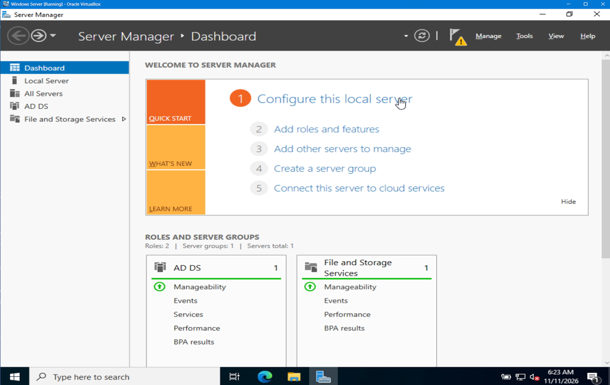
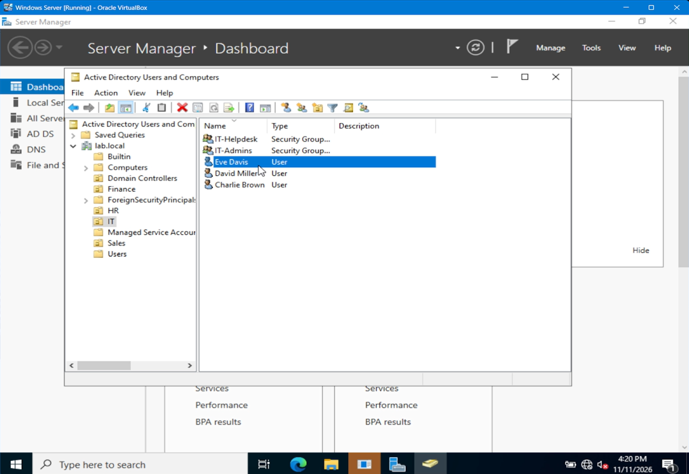
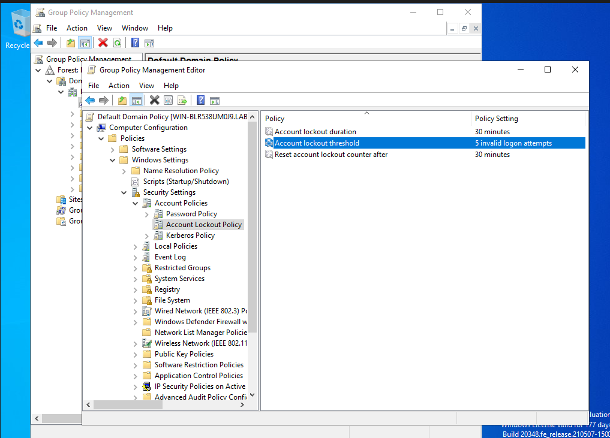

# Active Directory Infrastructure Lab 🏢

## 1. Scenario
Building a functional enterprise IT environment from scratch. 

I installed Windows Server 2022 on a VirtualBox VM, promoted it to a Domain Controller (`lab.local`), and provisioned a structured Active Directory environment.

**The goal:** Deploy a functional Windows Server 2022 Domain Controller (`lab.local`) to manage departmental users through OUs and RBAC security groups, enforce password lockout protection via GPO, and prepare the directory for automated Joiner-Mover-Leaver operations.

> This is a local lab environment. All configurations follow standard enterprise practices for Role-Based Access Control (RBAC) and least privilege.

---

## 2. Directory structure

```text
lab.local (Root Domain)
│
├── Finance (OU)
│   ├── Finance-Readers (Security Group)
│   ├── a.smith (User)
│   └── j.doe (User)
│
├── HR (OU)
│   ├── HR-Admins (Security Group)
│   ├── b.johnson (User)
│   └── e.watson (User)
│
├── IT (OU)
│   ├── IT-Admins (Security Group)
│   ├── IT-Helpdesk (Security Group)
│   ├── c.brown (User)
│   ├── d.miller (User)
│   └── e.davis (User)
│
└── Sales (OU)
    ├── Sales-Managers (Security Group)
    ├── Sales-Representatives (Security Group)
    ├── f.wilson (User)
    ├── g.taylor (User)
    └── h.white (User)
```

---

## 3. Configuration log (Step by step)

**Step 1: Base server installation.**

- Installed Windows Server 2022 Evaluation on VirtualBox.
- Configured a static IP address to ensure stable DNS resolution across the local network.

**Step 2: Active Directory Domain Services (AD DS).**

- Installed the AD DS role and promoted the server to a Domain Controller for a new root domain: `lab.local`.



**Step 3: Organizational Units and RBAC.**

- Created 4 department OUs.
- Provisioned 10 standard user accounts and distributed them into role-based security groups (e.g., `Finance-Readers`). 

Users were never granted direct access to resources, enforcing the **Principle of Least Privilege.**



**Step 4: Group Policy Object (GPO) enforcement.**

- Created a custom GPO linked to the domain root to enforce an account lockout policy (lockout after 5 invalid attempts for 30 minutes). 

*This protects the environment against brute-force and password-spraying attacks.*



---

## 4. Naming conventions and rules

I established strict naming rules before creating objects. Unstructured directories quickly become unmanageable during access reviews.

| Object | Format | Example | Why? |
|---|---|---|---|
| **Users** | `[First Initial].[Last Name]` | `j.doe` | Standard corporate format. Avoids conflicts with common first names. Matches email prefixes. |
| **Groups** | `[Department]-[Role]` | `HR-Admins` | Immediately answers "what access does this group have?" without needing to check permissions manually. |
| **OUs** | Exact business department | `Finance` | Makes it easy to target specific GPOs to isolated business units. |

---

## 💡 What I learned:

### **RBAC is mandatory.**
Assigning permissions directly to a user (`j.doe`) instead of a group (`Finance-Readers`) is a security risk. 

When John moves to HR, finding and revoking his direct folder permissions is an administrative nightmare. Security groups solve this.

### **GPOs are inherited.**
Linking the lockout policy to the root `lab.local` domain means it automatically cascades down to all OUs. I don't need to apply it to HR and Finance separately.

### **Kerberos and LDAP in practice.**
LDAP is how the system queries the directory structure to find where `j.doe` is located. 
**Kerberos is what actually issues the ticket when John types his password to log in.**

### **From manual GUI to PowerShell automation.**
Creating 10 users through ADUC builds baseline familiarity, but onboarding or offboarding at scale requires scripts. 

**This directory structure is now automated in [Week 4: PowerShell JML Automation](../powershell-jml-automation).**
